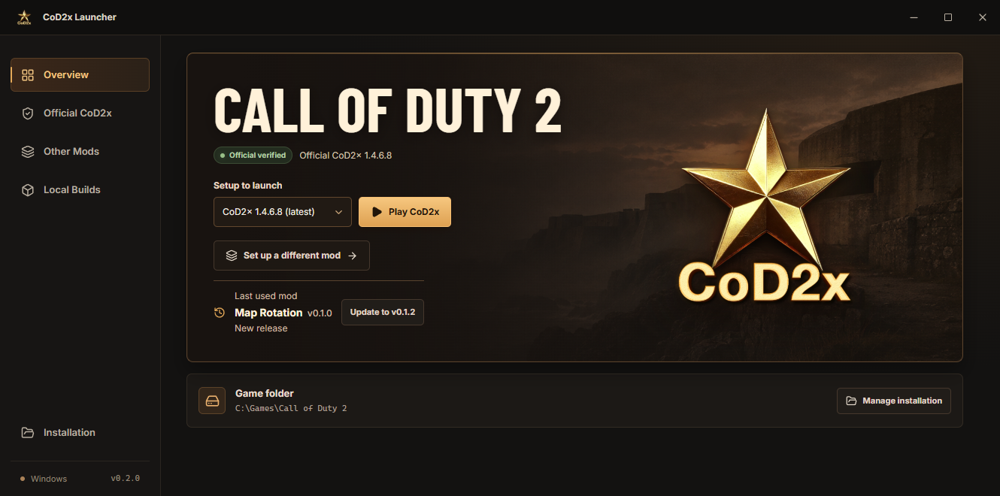

# CoD2x Launcher

A community Windows launcher for switching between official CoD2x and test builds. Pick a setup, play, and restore official CoD2x in one click when you’re done testing.

## Get started

1. [Download the portable Windows x64 launcher](https://github.com/laspencer91/cod2x-launcher/releases/latest/download/cod2x-launcher.exe).
2. Save `cod2x-launcher.exe` where you want to keep it, double-click it, and confirm your Call of Duty 2 folder.
3. Choose and play an official version from the Overview card. **Official releases** opens the upstream changelog on GitHub. Browse **Other Mods** for community releases or import a package in **Local Builds**.

The Overview remembers the last mod used in each game folder. It checks for published updates and shows the version before you switch. Local builds show their saved version.

The launcher verifies official downloads and backs up the mod files it manages when switching setups. Bring your own Call of Duty 2 installation.

## Publish a mod

Open **Other Mods → Publish a mod**. Select your build files, export a ZIP and descriptor, and upload both to a release in your own GitHub repo. Click **Submit for review** to have GitHub prepare your catalog pull request. Once a maintainer approves it, players see your mod and its future releases. **Copy publishing prompt** gives your coding agent the instructions to publish and submit it for you. [Publishing guide](docs/publishing.md)

## Build from source

On Windows, install Node.js and the [Tauri prerequisites](https://v2.tauri.app/start/prerequisites/). Run `npm ci`, then `npm run tauri dev`. To build a release, run `npm run tauri build` on Windows x64. Upload `src-tauri/target/release/cod2x-launcher.exe` as the sole release asset. Keep the filename stable so the download link above works across versions.

[MIT licensed](LICENSE) · [Official CoD2x project](https://github.com/callofduty2x/CoD2x) · [Mod catalog](https://github.com/laspencer91/cod2x-mod-catalog)
