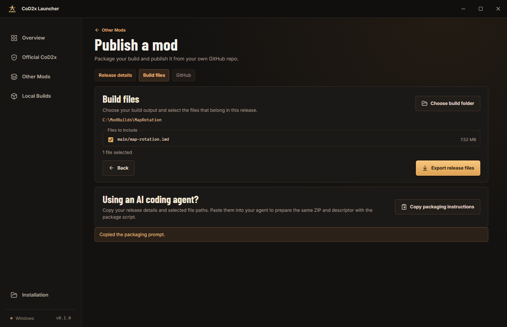

# Publish a mod

Each mod uses its own public GitHub repository. Once the catalog lists it, anyone with release access to that repository can publish updates. Players can browse and install without signing in.

## Prepare a release

1. In the launcher, open **Other Mods → Publish a mod**.
2. Enter the display name, stable lowercase mod ID, version, official CoD2x baseline, author credits, and description. Add release notes if you have them. The baseline supplies verified dependencies such as the original audio DLL for a custom client. Your mod has its own version.
3. Choose the build output folder. Select only the files you intend to ship. The scanner suggests a custom **mss32.dll** and mod **.iwd** files inside **main/**. Official archives and a recognized official DLL are excluded. Use the build output so other mods and downloaded maps are easy to avoid.
4. The optional AI helper copies preparation instructions using the details and paths you entered. **Export release files** creates **mod.zip** and **mod.json** in a versioned output folder. The descriptor contains the package metadata, size, and SHA-256.
5. **Open GitHub release draft** takes you to the mod repo’s Releases form. Use tag **v<version>** and attach **both** assets with their exact filenames. Publish the release through GitHub.
6. For a new mod, click **Open listing request**. This opens the [catalog repository’s issue form](https://github.com/laspencer91/cod2x-mod-catalog/issues/new?template=publisher-request.yml). Your account is the issue author. Review and submit the request in GitHub.

Existing listings pick up subsequent releases from the same repo. Keep the mod ID fixed and increment the version when any payload changes.



## Repository layout

A repo just needs a default branch and published releases. The branch can contain your source, a README, or both. A public release uses **v<version>** as the tag and includes **mod.zip** and **mod.json** as assets. The launcher checks that the descriptor matches the approved mod ID, tag, archive size, and GitHub release digest.

A catalog entry is **{"id":"your-mod-id","repository":"owner/your-mod-repo"}** in the **mods** array of the catalog’s **catalog.json**. Forks of the launcher can choose their own registry using **COD2X_MODS_REPOSITORY** at build time. The default is the public CoD2x Mod Catalog linked above.

## Use the same flow from a script

**Copy packaging instructions** fills in your metadata and selected paths. You can also run the package helper through PowerShell or give these commands to a coding agent.

```powershell
$build = @{
    Source       = 'C:\Builds\MyMod'
    Id           = 'my-mod'
    Name         = 'My Mod'
    Version      = '0.1.0'
    BaseVersion  = '1.4.6.8'
    Description  = 'A short description of the build.'
    Authors      = @('Your public name')
    Kind         = 'addon'
    Files        = @('main/my-mod.iwd')
    ReleaseNotes = 'Initial release.'
    ReleaseAssets = $true
    Output       = 'C:\Builds\Release\mod.zip'
}
.\tools\New-ModPackage.ps1 @build
```

For a custom client, use **Kind = 'runtime'** and add **mss32.dll** to **Files**. Create the output directory first. The script writes **mod.json** next to the ZIP. It prints the JSON descriptor for automation.

With an authenticated GitHub CLI, an author can create a draft using their own repo permissions.

```powershell
gh release create v0.1.0 C:\Builds\Release\mod.zip C:\Builds\Release\mod.json --repo owner/my-mod --title 'My Mod 0.1.0' --draft
```

Review and publish that draft on GitHub. Submitted versions are public downloads. Use **Local Builds** for private testing.
